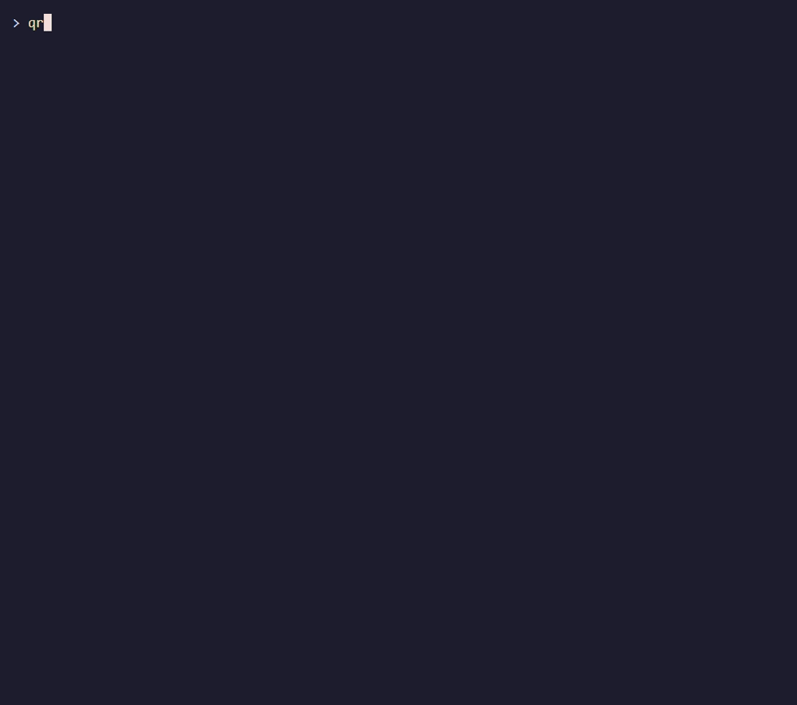
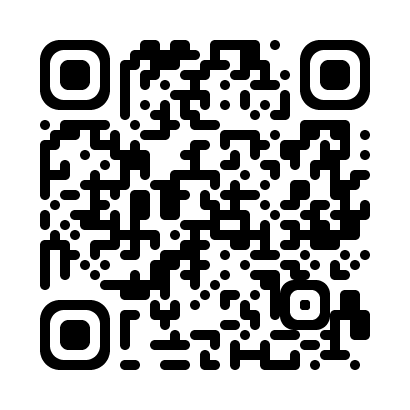
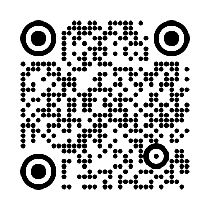
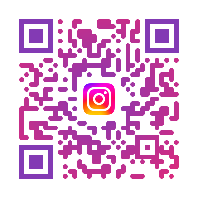

# qrgen

QR code generator, decoder and offline phishing inspector, written from scratch in JavaScript with zero runtime dependencies.

[](https://github.com/jmendoza167/Qr-Code-Generator/actions/workflows/test.yml)
[](https://www.npmjs.com/package/@jmendoza167/qrgen)
[](LICENSE)
[](https://nodejs.org/)



- Encoder for all 40 versions, four error correction levels and the numeric, alphanumeric and byte (UTF-8) modes, with Reed-Solomon, masking and BCH format codes implemented from the ISO/IEC 18004 specification.
- Output to the terminal, SVG and PNG, with rounded or dotted modules, finder styles, colours, gradients and a centre logo.
- Presets for Wi-Fi credentials and vCard contacts.
- A decoder that reads PNG images back, with real error correction, and `qrgen inspect`, which analyses the decoded content for phishing signals without touching the network.
- The engine, presets, decoder and inspector use no Node APIs, so they run in a browser.

## Quick start

```powershell
npx @jmendoza167/qrgen "hello world"
```

Or install the command globally:

```powershell
npm install -g @jmendoza167/qrgen
qrgen "hello world"
```

Requires Node.js 22 or newer. There are no runtime dependencies.

<details>
<summary>Run from a clone instead</summary>

```powershell
git clone https://github.com/jmendoza167/Qr-Code-Generator.git qrgen
cd qrgen
npm install        # dev dependencies, only needed for npm test
npm link           # makes "qrgen" point at this folder
qrgen --version
```

Remove it later with `npm unlink -g @jmendoza167/qrgen`.

</details>

## Usage

```text
qrgen [text] [options]
qrgen wifi --ssid <name> [--pass <password>] [options]
qrgen contact --name <name> [contact fields] [options]
qrgen inspect <image.png> [--json]
```

Without a text argument, the text is read from standard input. To encode a word that is also a command name, put it after `--`: `qrgen -o out.png -- wifi`. Every command has `--help`.

### Print in the terminal

```powershell
qrgen "https://example.com" --info
```

```text
Version: 2 (25x25 modules)
Mode:    byte
ECC:     M
Mask:    2
```

The code itself is drawn with Unicode half blocks above that summary. Use `--ascii` for terminals that render block characters badly, and `--invert` if your scanner refuses the light-on-dark code that a dark theme produces.

### Save as SVG or PNG

```powershell
qrgen "https://example.com" -o qr.png -s 8 --fg "#1a237e" --bg "#fffde7"
qrgen "https://example.com" -o qr.svg -m 2 -e H
```

The file extension picks the format. `-s` is pixels per module, `-m` the quiet zone in modules, `-e` the error correction level.

<details>
<summary>All output options</summary>

| Option | Description | Default |
| --- | --- | --- |
| `-o, --output <file>` | Save to a file; `.png` or `.svg` | terminal |
| `-e, --ecc <L\|M\|Q\|H>` | Error correction level | `M` |
| `-s, --scale <n>` | Pixels per module (PNG/SVG) | `10` |
| `-m, --margin <n>` | Quiet zone in modules | `4` |
| `--fg <hex>` | Foreground colour (PNG/SVG) | `#000000` |
| `--bg <hex>` | Background colour (PNG/SVG) | `#ffffff` |
| `--ascii` | Print with `##` instead of half blocks | |
| `--invert` | Swap dark and light in the terminal | |
| `--info` | Also print version, mode, ECC level and mask | |
| `-h, --help` | Show help | |
| `-v, --version` | Show the version number | |

Exit codes for the generating commands: `0` success, `1` encoding or file error (text too long, cannot write the file), `2` usage error. Warnings and notes go to stderr, so stdout only carries the code or the `Saved ...` line.

</details>

### Styles and colours

```powershell
qrgen "https://example.com" -o styled.png --shape rounded --finder circle --finder-color "#b71c1c"
qrgen "https://example.com" -o gradient.svg --shape dots --gradient "#1a237e,#00897b" --gradient-dir radial
```

| Option | Values |
| --- | --- |
| `--shape` | `square` (default), `rounded`, `dots` |
| `--finder` | `square` (default), `rounded`, `circle` |
| `--finder-color <hex>` | Separate colour for the three finder patterns |
| `--gradient <hex1,hex2>` | Gradient fill for the dark modules |
| `--gradient-dir` | `horizontal`, `vertical`, `diagonal` (default), `radial` |

Styles apply to PNG and SVG only; the terminal shows the plain code. Keep dark modules on a light background: qrgen warns when the contrast ratio is below 3:1 or the colours are inverted. Alignment patterns stay solid because scanners locate them. Test-scan a styled code before printing it in volume.

### Centre logo

```powershell
qrgen "https://example.com" -o with-logo.png --logo logo.png --logo-size 25 --logo-bg "#ffffff"
```

| Option | Description | Default |
| --- | --- | --- |
| `--logo <file.png\|.svg>` | Image for the centre; SVG logos only in `.svg` output | |
| `--logo-size <percent>` | Larger side as a percentage of the code width, max 30 | `20` |
| `--logo-padding <modules>` | Clear modules around the logo | `1` |
| `--logo-bg <hex>` | Fill the cleared area with a colour | none |

A logo forces error correction level H and never covers the finder, timing or alignment patterns scanners need; qrgen moves to a larger version when the requested size would. PNG logos must be 8-bit and non-interlaced; JPEG, interlaced and 16-bit files are rejected with a message that says what to convert.

### Gallery

| Rounded | Dots and circle finders | Gradient | Logo and radial gradient |
| --- | --- | --- | --- |
|  |  |  |  |

Every image, with the exact command that produced it, is in the [examples gallery](docs/examples/README.md).

### Wi-Fi and contact presets

```powershell
qrgen wifi --ssid "Home"
qrgen wifi --ssid "Cafe" --security nopass -o cafe.png
qrgen contact --name "Javier Mendoza" --phone "+34 600 000 000" --email "javier@example.com" -o card.png
```

Without `--pass`, the Wi-Fi password is read from stdin when piped, otherwise prompted for without echo, so it stays out of your shell history. The resulting code contains the password in plain text, as the Wi-Fi format requires; qrgen prints a reminder.

<details>
<summary>Preset options</summary>

| `qrgen wifi` | Description |
| --- | --- |
| `--ssid <name>` | Network name (required) |
| `--pass <password>` | Password; omit to be prompted |
| `--security <WPA\|WEP\|nopass>` | Default `WPA` (WPA2/WPA3 use `WPA`) |
| `--hidden` | The network does not broadcast its SSID |

| `qrgen contact` | Description |
| --- | --- |
| `--name <full name>` | Required; the last word becomes the family name |
| `--phone <number>` | May be repeated |
| `--email <address>` | May be repeated |
| `--org`, `--title`, `--url`, `--address`, `--note` | Optional vCard 3.0 fields |

Both commands accept all output, style and logo options.

</details>

### Inspect a QR code before trusting it

```powershell
qrgen inspect poster.png
qrgen inspect --text "https://paypal.com@evil.example/login"
qrgen inspect poster.png --json
```

```text
Verdict: HIGH
Type: URL

Findings:
  [HIGH] Fake host before @: "paypal.com" is a username, not the site: the link really goes to evil.example.
  [LOW] Login or verification wording in the path: The path mentions "login". Normal on real sites, but it is what phishing pages look like too.

Content (escaped):
https://paypal.com@evil.example/login

This is a heuristic check of the decoded content only. It cannot prove that a QR code is safe: a clean result means none of the known warning signs were found, nothing more.
```

`inspect` decodes the image with qrgen's own decoder and analyses the content offline. It never opens the link, resolves the domain or asks a reputation service. It classifies the payload (URL, Wi-Fi, vCard, email, phone, SMS, location, text or other scheme) and reports:

- **URLs**: dangerous schemes (`javascript:`, `data:`, `file:`, `intent:`), `http://`, a fake host before `@`, IP-address hosts in dotted, decimal, hex or octal form, internationalised domains with mixed alphabets or lookalike characters, imitations of commonly phished brands (`paypa1.com`, `paypal-secure.com`, `paypal.com.evil.example`, `paypal.top`), link shorteners, odd ports, many subdomains, heavy or double percent-encoding, very long URLs, and login/verify wording in the path.
- **Wi-Fi**: open networks, WEP, hidden networks. **Contacts, emails, SMS**: links inside get the URL checks; pre-filled bodies are flagged.
- **Any payload**: control characters and bidirectional override characters. **The symbol**: a Latin-1 fallback, an ECI designator, or many corrected codewords (possible damage or a sticker over the original).

The decoded content is untrusted and is always printed with control characters and bidirectional overrides shown as escapes (`\x1b`, U+202E), never interpreted by your terminal. The brand, shortener and scheme lists in `src/inspect/data.js` are small and deliberately non-exhaustive: matching nothing is not a clean bill of health, and the report says so every time.

| Exit code | Meaning |
| --- | --- |
| `0` | no findings, or only low ones |
| `2` | verdict medium or high |
| `1` | error: unreadable image, no QR code found, bad arguments |

Unlike the other commands, usage mistakes exit `1` here, so `2` always means "suspicious" in scripts. `--json` prints the report (`verdict`, `type`, `findings`, `text`, `meta`, `disclaimer`, `exitCode`) with the text raw; JSON escaping keeps it safe.

<details>
<summary>Notes for Windows terminals</summary>

- **Dark themes.** Dark modules are drawn in the text colour, so a dark theme gives a light-on-dark code. Most phone scanners read it; if yours does not, add `--invert`.
- **Piping non-ASCII text in Windows PowerShell 5.1.** PowerShell 5.1 sends piped text to native programs as ASCII, so accents become `?` before qrgen sees them. Pass the text as an argument, use PowerShell 7, or run this once in the session:

  ```powershell
  $OutputEncoding = [Console]::OutputEncoding = [System.Text.Encoding]::UTF8
  ```

- `echo` adds a line break; qrgen strips one trailing line break from stdin.

</details>

## Library

Everything the CLI does is available as functions.

### Encode and render

```js
import { encode, renderTerminal, renderSvg, renderPng, buildWifiPayload, buildVCard } from '@jmendoza167/qrgen';
import { writeFileSync } from 'node:fs';

const qr = encode('hello world', { ecc: 'Q' });
// { matrix, size, version, ecc, mask, mode }; matrix[row][col] === true means dark

console.log(renderTerminal(qr.matrix));
writeFileSync('qr.svg', renderSvg(qr.matrix, { scale: 8, shape: 'rounded', gradient: '#1a237e,#00897b' }));
writeFileSync('qr.png', renderPng(qr.matrix, { scale: 8, finder: 'circle', finderColor: '#b71c1c' }));

// Presets build the text; encoding is the same
const wifi = encode(buildWifiPayload({ ssid: 'Home', password: 'secret' }));
const card = encode(buildVCard({ name: 'Javier Mendoza', phones: ['+34 600 000 000'] }));
```

`encode(text, options)` accepts `ecc` (`'L' | 'M' | 'Q' | 'H'`, default `'M'`), `version` (force 1 to 40), `minVersion`, `maxVersion` and `mask` (force 0 to 7), and throws `DataTooLongError` when the text does not fit. `renderSvg` and `renderPng` share `scale`, `margin`, `fg`, `bg`, `shape`, `finder`, `finderColor`, `gradient`, `gradientDir` and `logo`.

```js
import { encodeWithLogo, renderPng, decodePng } from '@jmendoza167/qrgen';
import { readFileSync, writeFileSync } from 'node:fs';

// encodeWithLogo picks level H and a version with room; plan.matrix has the centre cleared
const image = decodePng(readFileSync('logo.png'));
const { plan } = encodeWithLogo('https://example.com', { sizePercent: 25, aspect: image.width / image.height });
writeFileSync('with-logo.png', renderPng(plan.matrix, { logo: { image, box: plan.box, area: plan.area, bg: '#ffffff' } }));
```

### Decode and inspect

```js
import { decodeQrPng, decodeQr, NoQrFoundError } from '@jmendoza167/qrgen';
import { inspectPayload, formatReport } from '@jmendoza167/qrgen/inspect';
import { readFileSync } from 'node:fs';

const decoded = decodeQrPng(readFileSync('poster.png'));
// { text, version, ecc, mask, errorsCorrected, encoding, eci, inverted, location, ... }
// decodeQr({ width, height, data }) does the same for RGBA pixels, e.g. a canvas ImageData

const report = inspectPayload(decoded.text, decoded);
// { verdict: 'none' | 'low' | 'medium' | 'high', type, findings, text, meta, disclaimer }
console.log(formatReport(report, { escape: (s) => JSON.stringify(s).slice(1, -1) }));
```

Decoding throws `NoQrFoundError`, `FormatUnreadableError`, `TooManyErrorsError` or `UnsupportedContentError` (all `QrDecodeError`) and never returns partially corrected data. `decoded.text` is raw: pass an escape function to `formatReport` before printing it.

### In the browser

The engine, presets, decoder and inspector have no Node dependencies. Import the browser-safe entry points:

| Entry point | Exports |
| --- | --- |
| `@jmendoza167/qrgen/core` | `encode`, `detectMode`, `getCapacity`, `DataTooLongError` |
| `@jmendoza167/qrgen/render/svg`, `/render/terminal` | `renderSvg`, `renderTerminal` |
| `@jmendoza167/qrgen/decode` | `decodeQr`, `readMatrix` and the decode errors |
| `@jmendoza167/qrgen/inspect` | `inspectPayload`, `formatReport`, `classifyPayload`, `inspectUrl` |

```js
import { encode } from '@jmendoza167/qrgen/core';
import { renderSvg } from '@jmendoza167/qrgen/render/svg';

document.getElementById('out').innerHTML = renderSvg(encode('hello').matrix, { shape: 'dots' });
```

Only the PNG writer and reader, and therefore the CLI, need Node. A test fails if a browser-safe file starts importing Node APIs.

## How it works

Everything follows ISO/IEC 18004, one step per file in `src/core/` and `src/decode/`. The comments in those files go into the details.

- **Modes and versions.** Digits use numeric mode (10 bits per 3 digits), uppercase text alphanumeric mode (11 bits per 2 characters), everything else byte mode with UTF-8. The smallest version (1 to 40) whose capacity fits the text is chosen; the bit stream gets a terminator, byte alignment and the `0xEC 0x11` pad codewords.
- **Reed-Solomon.** Data codewords are treated as a polynomial over GF(256), the field of bytes with XOR as addition and multiplication modulo `0x11D`. The remainder of dividing by a generator polynomial becomes the error correction codewords. Larger symbols split the data into blocks and interleave them, so a localised smudge damages a little of every block.
- **Matrix and masking.** Finder, timing and alignment patterns are drawn, the codewords are placed along the zigzag path, and all eight mask patterns are scored with the four penalty rules. The chosen mask and the ECC level go into a 15-bit BCH-protected format code; versions 7 and up also carry an 18-bit version code.
- **Decoding.** The image is binarised with a local threshold, the three finder patterns are located by their 1:1:3:1:1 run ratio, the grid is sampled through an affine map of their centres, format and version codes are corrected to the nearest valid codeword, the data is unmasked and de-interleaved, and every block goes through syndromes, Berlekamp-Massey, Chien search and Forney. A block that cannot be corrected with certainty is an error, never a guess.
- **Styles and logos.** Styles turn the matrix into geometric primitives drawn by both the SVG and the PNG renderer. The logo planner clears a centred block of modules that level H error correction then compensates for.

## Security

Everything that reads untrusted input is bounded and tested against the actual attack:

- SVG logos are sanitised and embedded as data URI images, so their markup never executes.
- The PNG reader caps dimensions before inflating and stops at the declared size, which defuses decompression bombs; corrupt files fail with a clear error.
- The QR decoder shares those size caps, bounds every loop, and is tested with noise, fields of finder-like squares, destroyed format information and 16-megapixel images in a child process with time and memory limits.
- `inspect` works entirely offline, prints decoded content with control characters escaped, and a test fails if its code imports any networking module.
- Payload fields reject control characters, and stdin is bounded.

To report a vulnerability, use GitHub's private reporting rather than a public issue; see [SECURITY.md](SECURITY.md) for scope, what to include and what to expect.

## Development

```powershell
npm test            # node --test, no build step
npm run coverage    # c8 text summary plus an HTML report in coverage/
```

CI runs the suite on Ubuntu, Windows and macOS with Node 22 and 24 on every push and pull request. The suite checks GF(256) and Reed-Solomon against published values, every codeword count in the standard's Table 7, round trips through jsQR for all modes, levels and masks, the decoder against the encoder for every version and against jsQR on the same images, and the inspector with a triggering and a benign case for every check.

The demo GIF is recorded with [VHS](https://github.com/charmbracelet/vhs) from `docs/demo.tape`; with `vhs`, `ttyd` and `ffmpeg` installed, `npm run demo` regenerates it.

## License

MIT. See [LICENSE](LICENSE).

QR Code is a registered trademark of DENSO WAVE INCORPORATED.
