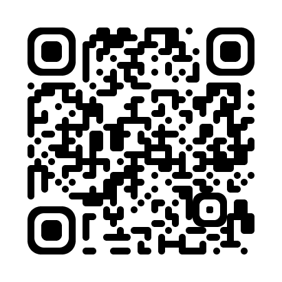
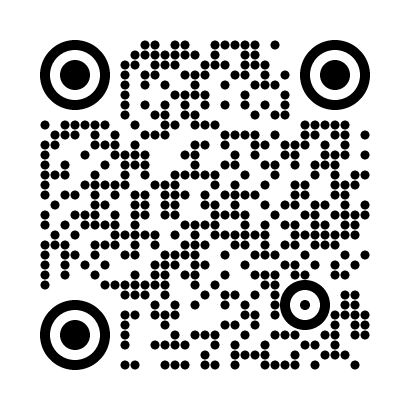
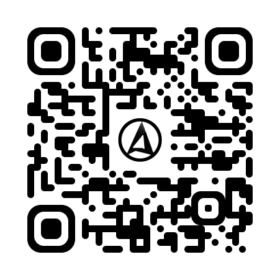
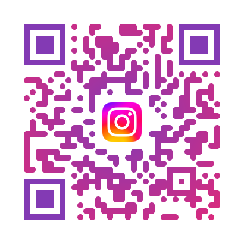
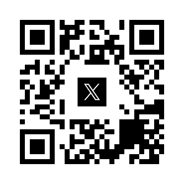

# qrgen examples

Hand-made examples: each image below was produced with the command next to
it (file names were changed afterwards to the ones shown). A test decodes
every PNG in this folder with jsQR and checks the content, so the commands
and images stay in sync.

In the logo examples, `your-logo.png` stands for the logo file that was
used; the logo files themselves are not part of the repository.

| Preview | PowerShell command | Description |
| --- | --- | --- |
|  | `qrgen "https://github.com/jmendoza167/Qr-Code-Generator" -o plain.png` | Plain black and white, the default output. |
|  | `qrgen "https://example.com" -o colors.svg --fg "#1a237e" --bg "#fffde7"` | SVG output with custom foreground and background colours. |
|  | `qrgen "https://github.com/jmendoza167/Qr-Code-Generator" -o rounded.png --shape rounded --finder rounded` | Rounded modules and rounded finder patterns. |
|  | `qrgen "https://github.com/jmendoza167/Qr-Code-Generator" -o dots.png --shape dots --finder circle` | Dotted modules with circular finder patterns. |
|  | `qrgen "https://github.com/jmendoza167/Qr-Code-Generator" -o gradient.png --gradient "#1a237e,#00897b" --gradient-dir diagonal` | Diagonal gradient over the dark modules. |
|  | `qrgen "https://github.com/jmendoza167" -o logo-photo.png --logo your-logo.png --shape rounded --finder rounded` | A photo as the centre logo; error correction level H is forced automatically. |
|  | `qrgen "https://instagram.com/jmendoza.16" -o logo-instagram.png --logo your-logo.png --shape rounded --gradient "#833ab4,#dd2a7b" --gradient-dir radial --finder-color "#833ab4"` | Logo plus radial gradient and a matching finder colour. |
|  | `qrgen "https://www.linkedin.com" -o logo-linkedin.png --logo your-logo.png --shape dots --finder circle --fg "#0A66C2"` | Logo with dotted modules, circular finders and a single brand colour. |
|  | `qrgen "https://x.com" -o logo-x.svg --logo your-logo.png --logo-padding 2 --logo-bg "#ffffff"` | SVG output with a PNG logo embedded as a data URI, 2 modules of padding and a white logo background. |

## Wi-Fi (no image on purpose)

```powershell
qrgen wifi --ssid "YourNetwork" -o wifi.png
qrgen wifi --ssid "YourNetwork" --security WPA --hidden -o wifi.png
qrgen wifi --ssid "CafeGuest" --security nopass -o wifi.png
```

Leaving out `--pass` makes qrgen prompt for the password with hidden input
(nothing is echoed and nothing lands in your shell history). The resulting
image contains the password in plain text, exactly as the Wi-Fi QR format
requires, so never commit it or share it publicly. That is why this gallery
has no Wi-Fi example image.
